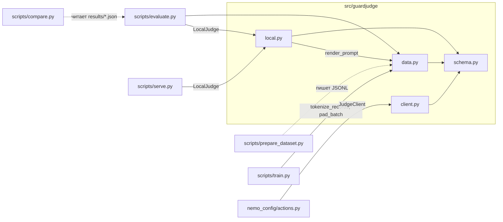

# Карта кода GuardJudge

Справка по Python-файлам проекта: что в каждом файле и что делают функции и классы.

## Как модули связаны

Главная идея: **один и тот же текст промпта** используется при обучении и на инференсе.
Его собирает `data.render_prompt` из `schema.build_messages` и chat template модели.
Loss считается только по JSON-вердикту.

---

## `src/guardjudge/schema.py` — промпт и вердикт (только стандартная библиотека)

- `STAGES`: `input`, `tool_call`, `rag`, `output`.
- `CATEGORIES`: `none`, `jailbreak`, `prompt_injection`, `harmful_content`, `data_exfiltration`, `tool_abuse`, `rag_poisoning`.
- `SYSTEM_PROMPT`, `STAGE_HINTS`: системная инструкция судьи и описание каждой стадии.
- `Verdict(unsafe, category, parsed_ok)`: результат проверки.
- `build_user_prompt(stage, text, context=None) -> str`: текст user-сообщения (стадия, описание стадии, контекст, фрагмент).
- `build_messages(stage, text, context=None) -> list[dict]`: system + user сообщения.
- `format_target(label, category) -> str`: целевой JSON. Для `safe` категория всегда `none`.
- `parse_verdict(raw, controversial_is_unsafe=True) -> Verdict`: разбирает наш JSON, а также нативные форматы Qwen3Guard (`Safety: ...`) и Llama Guard (`unsafe\nS1`), чтобы оценивать baseline-модели. Если разобрать не удалось, возвращает `parsed_ok=False`.

## `src/guardjudge/data.py` — данные и токенизация

- `load_jsonl(path) -> list[dict]`: читает JSONL и проверяет `stage`, `label`, `category` и непустой `text`. Лишние поля разрешены.
- `CHATML_NO_THINK`, `CHAT_TEMPLATES`, `apply_chat_template_override(tokenizer, name)`: заменяют chat template токенизатора на простой ChatML с пустым `<think>` (`name="chatml"`). Нужно для Qwen3Guard-Gen: её родной шаблон заворачивает диалог в собственную инструкцию классификации. С этим шаблоном Qwen3 и Qwen3Guard получают побайтово одинаковые промпты.
- `render_prompt(tokenizer, messages, chat_template_kwargs) -> str`: применяет chat template модели с `add_generation_prompt=True`.
- `tokenize_example(tokenizer, rec, max_length, chat_template_kwargs) -> dict | None`: возвращает `input_ids = prompt + verdict + EOS` и `labels`, где промпт заменён на -100. Если пример длиннее `max_length`, возвращает `None`.
- `tokenize_records(...) -> (examples, skipped)`: применяет `tokenize_example` ко всему набору.
- `pad_batch(features, pad_token_id)`: паддинг справа; `labels` дополняются -100.
- `IGNORE_INDEX = -100`.

## `src/guardjudge/local.py` — инференс через Transformers

`LocalJudge(model_path, device=None, dtype="auto", chat_template_kwargs=None, chat_template=None, max_new_tokens=32)`
- Загружает модель и токенизатор. `dtype=auto`: на GPU bf16, если он поддерживается, иначе fp16; на CPU fp32.
- `chat_template_kwargs` берутся из `guardjudge.json` чекпоинта, если файл есть. Иначе используется `{"enable_thinking": False}`.
- `generate(messages, max_new_tokens=None, chat_template_kwargs=None) -> (text, n_prompt, n_completion)`: жадная генерация. Защищена блокировкой, поэтому безопасна для сервера.
- `generate_batch(batch) -> list[str]`: пакетная жадная генерация с паддингом слева, для быстрой оценки.
- `judge(stage, text, context=None) -> Verdict`.
- `chat_template="chatml"` переопределяет шаблон. У дообученного чекпоинта переопределённый шаблон уже сохранён в токенизаторе.

## `src/guardjudge/client.py` — клиент к серверу

`JudgeClient(base_url, model, api_key, timeout, fail_open)` — асинхронный клиент к OpenAI-совместимому API.
Значения по умолчанию берутся из `GUARDJUDGE_BASE_URL`, `GUARDJUDGE_MODEL` и `GUARDJUDGE_FAIL_OPEN`.
- `await judge(stage, text, context) -> Verdict`. Если сервер недоступен **или ответ модели не удалось разобрать**, по умолчанию возвращает `unsafe` (fail closed).

---

## `scripts/prepare_dataset.py`

Конвертирует `guardrails_dataset/{train,validation,test}.jsonl` в `data/guardrails/{train,val,test}.jsonl`.
- `convert(rec) -> dict`: `is_unsafe` → `label`. Структурированный `text` разбирается так: `untrusted_content` → `text`, `trusted_instruction` и `user_task` → `context`. Поля `id`, `source`, `language`, `subcategory` сохраняются.

## `scripts/train.py`

Полное дообучение через `transformers.Trainer`.
- `resolve_precision(precision, cuda, bf16_ok) -> (bf16, fp16)`: если bf16 не поддерживается, переключается на fp16.
- `show_example(tok, ex)`: печатает часть примера без loss (промпт) и часть с loss (вердикт).
- `apply_overrides(cfg, ["train.epochs=1", ...])`: флаг `--set` (значения разбираются как YAML).
- `subsample(records, n, seed)`: `max_train_samples` / `max_eval_samples`.
- `verdict_only_loss(model, input_ids, attention_mask, labels) -> (sum, n)`: loss только по токенам вердикта. Скрытые состояния проходят через `lm_head` только на целевых позициях, полные логиты по словарю (batch × seq × 152k) не создаются. Значение и градиенты те же, что у стандартного loss. На батче 4 × 1024 для Qwen3-0.6B пик памяти 1.7 ГиБ вместо 7.2 ГиБ.
- `make_trainer_class(Trainer)` → `VerdictLossTrainer`: `compute_loss` на основе `verdict_only_loss` с той же нормировкой при накоплении градиентов, что у стандартного Trainer (проверено: одинаковые веса после шагов в transformers 4.57 и 5.22).
- `compat_training_args(cls, kwargs, group_by_length)`: совместимость с transformers 4.x и 5.x. Группировка по длине включается через `group_by_length=True` (4.x) или `train_sampling_strategy="group_by_length"` (5.x). Неизвестные аргументы отбрасываются с предупреждением.
- `main()`: читает YAML и токенизирует данные. Если в конфиге задан `chat_template`, сначала применяется он. С `--dry-run` на этом останавливается. Иначе загружает модель в fp32, обучает со смешанной точностью (`eval_save_every`: по эпохам или каждые N шагов; `--resume` продолжает с чекпоинта) и сохраняет чекпоинт в `save_dtype` вместе с `guardjudge.json` (конфиг и `log_history` для графиков loss). Промежуточные чекпоинты удаляются, если не задан `keep_checkpoints`.

## `scripts/evaluate.py`

- `LocalBackend` (LocalJudge: пакетный проход для качества и поштучные замеры задержки на `--latency-samples` примерах) и `HttpBackend` (OpenAI-совместимый сервер, задержка каждого запроса).
- `raw_messages(rec)`: промпт без нашей инструкции, для guard-моделей со своим шаблоном (`--prompt-style raw`).
- `metrics(rows)`: tp/fp/fn/tn, accuracy, precision, recall, F1, FPR, parse_fail, задержка p50/p95.
- `group_metrics(rows, key)`: те же метрики по `source` или `language`.
- Флаги: `--name` (подпись в отчётах), `--limit N` (случайная подвыборка), `--batch-size`, `--latency-samples`, `--chat-template chatml`, `--controversial unsafe|safe`, `--warmup`, `--save-predictions`.

## `scripts/compare.py`

- `build(reports) -> str`: Markdown-таблицы по нескольким отчётам `evaluate.py`: в целом (P/R/F1/FPR/задержка), F1 по источникам и языкам, recall по категориям атак.

## `scripts/serve.py`

FastAPI-сервер поверх `LocalJudge`:
- `GET /health`, `GET /v1/models`;
- `POST /v1/chat/completions` (OpenAI-совместимый);
- `POST /judge {stage, text, context}` → `{verdict, category, parsed_ok, latency_s}`. Неразобранный ответ модели даёт `unsafe` (флаг `--fail-open` меняет это), неизвестная стадия — HTTP 422.

## `scripts/serve_vllm.sh`

Запуск чекпоинта через `vllm serve` на порту 8001 под именем `guardjudge`.

## `nemo_config/`

- `actions.py`: `guardjudge_check(stage, text, context) -> bool` и `guardjudge_filter_chunks(context)`, которая удаляет из RAG небезопасные чанки.
- `rails.co`: рельсы на input, output и retrieval. Рельс для tool calls пока не сделан (TODO).

## `tests/test_schema.py`

Проверяет разбор вердиктов (JSON, Qwen3Guard, Llama Guard), валидацию демо-данных,
маску loss (с токенизатором-заглушкой, без скачивания модели), передачу `chat_template_kwargs`,
пропуск слишком длинных примеров и `pad_batch`.
