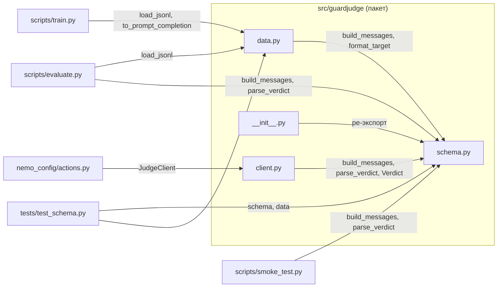

# Карта кода GuardJudge — функции и классы по файлам

Справка по всем Python-файлам проекта: что содержит каждый файл и что делают его
функции/классы. Формат записи: `имя(аргументы) -> возврат` и краткое описание.

## Как модули связаны



Ключевая идея: **один и тот же промпт** (`schema.build_messages`) используется и при
обучении, и при инференсе судьи, поэтому модель учится отвечать строгим JSON, а
`parse_verdict` умеет разбирать и JSON, и «нативный» формат Qwen3Guard.

---

## `src/guardjudge/__init__.py`

Пакетный инициализатор. Ничего не выполняет, только **ре-экспортирует** публичный API
из `schema.py`, чтобы импортировать коротко:

```python
from guardjudge import Verdict, parse_verdict, build_messages, format_target, STAGES, CATEGORIES
```

---

## `src/guardjudge/schema.py`

Отвечает за промпт судьи, формат целевого ответа и разбор вердикта. Не зависит от
внешних библиотек (только стандартная).

### Константы
- `STAGES: tuple[str, ...]` — стадии пайплайна: `input`, `tool_call`, `rag`, `output`.
- `CATEGORIES: tuple[str, ...]` — таксономия категорий: `none`, `jailbreak`,
  `prompt_injection`, `harmful_content`, `data_exfiltration`, `tool_abuse`, `rag_poisoning`.
- `SYSTEM_PROMPT: str` — системная инструкция судьи: отвечать только JSON
  `{"verdict": "safe"|"unsafe", "category": "..."}`.
- `STAGE_HINTS: dict[str, str]` — человекочитаемое описание каждой стадии для промпта.
- Приватные регулярки `_JSON_RE`, `_NATIVE_RE`, `_CAT_RE` — для извлечения вердикта из «шумного» текста.

### `Verdict` (dataclass)
Результат проверки:
- `unsafe: bool` — признан ли фрагмент небезопасным;
- `category: str = "none"` — категория;
- `parsed_ok: bool = True` — удалось ли разобрать ответ модели (False = мусор/сбой парсинга).

### Функции
- `build_user_prompt(stage, text, context=None) -> str`
  Собирает пользовательскую часть промпта из стадии, её описания, необязательного
  контекста и самого фрагмента. Бросает `ValueError` при неизвестной стадии.
- `build_messages(stage, text, context=None) -> list[dict]`
  Возвращает готовый список сообщений Chat Completions: `[system, user]`.
  Используется и в обучении, и в клиенте/оценке — гарантирует одинаковый ввод.
- `format_target(label, category="none") -> str`
  Формирует **целевой** ответ для обучения — JSON-строку. Валидирует `label`
  (`safe`/`unsafe`) и `category`; при `label="safe"` принудительно ставит `category="none"`.
- `parse_verdict(raw, controversial_is_unsafe=True) -> Verdict`
  Разбирает ответ судьи. Сначала пытается вытащить JSON; если не вышло — распознаёт
  нативный формат Qwen3Guard (`Safety: Safe|Unsafe|Controversial` + `Categories: ...`),
  что позволяет мерить и baseline без дообучения. Флаг решает, считать ли
  `Controversial` небезопасным. На неразбираемом тексте возвращает `parsed_ok=False`.

---

## `src/guardjudge/data.py`

Загрузка датасета и приведение к формату обучения TRL. Зависит только от `schema.py`.

### Функции
- `load_jsonl(path) -> list[dict]`
  Читает JSONL (по одному JSON-объекту на строку), пропускает пустые строки и проверяет
  поля `stage` (должно быть из `STAGES`) и `label` (`safe`/`unsafe`).
  Бросает `ValueError` с номером строки при нарушении.
- `to_prompt_completion(rec) -> dict`
  Преобразует запись в формат TRL «prompt-completion»: `prompt` — сообщения судьи,
  `completion` — один ответ ассистента с целевым JSON. Loss считается только по
  completion.

Формат записи данных:
```json
{"stage": "rag", "text": "...", "context": "(необязательно)", "label": "unsafe", "category": "rag_poisoning"}
```

---

## `src/guardjudge/client.py`

Асинхронный клиент к модели-судье, поднятой за OpenAI-совместимым API (vLLM/Ollama).

### Класс `JudgeClient`
- `__init__(base_url=None, model=None, api_key="EMPTY", timeout=30.0, fail_open=None)`
  Настраивает `AsyncOpenAI`. Значения по умолчанию берутся из переменных окружения:
  `GUARDJUDGE_BASE_URL` (по умолчанию `http://localhost:8001/v1`),
  `GUARDJUDGE_MODEL` (по умолчанию `guardjudge`),
  `GUARDJUDGE_FAIL_OPEN` (`1` = пропускать при недоступности судьи).
- `async judge(stage, text, context=None) -> Verdict`
  Отправляет сообщения (`build_messages`) с `temperature=0`, `max_tokens=64` и парсит
  ответ через `parse_verdict`. **Fail-closed по умолчанию**: при любой ошибке
  подключения возвращает «unsafe», если не включён fail-open.

---

## `scripts/train.py`

QLoRA/LoRA-дообучение судьи. Запуск: `python scripts/train.py --config configs/train_lora.yaml`.
По умолчанию **plain LoRA + fp16** (совместимо с T4); 4-битная база — опция
`load_in_4bit: true`. Вся логика в `main()` (см. раздел «Про импорт обучения»).

### Функции
- `resolve_precision(precision) -> tuple[bool, bool, torch.dtype]`
  Переводит имя точности (`fp16`/`bf16`/`fp32`) в флаги `(use_bf16, use_fp16, dtype)`.
  Для `bf16` на GPU без его поддержки (T4/P100) автоматически откатывается на `fp16`
  с предупреждением.
- `resolve_device_map(name)`
  Для `single` возвращает `{"": <cuda:current>}`, чтобы закрепить модель за одним GPU
  (иначе `auto` шардирует модель на Kaggle «T4×2» и ломает DDP). **Бросает
  `RuntimeError`, если CUDA нет** (обучение только на GPU).
- `main()`
  Читает YAML-конфиг, грузит токенизатор и модель (plain LoRA через `torch_dtype` либо
  4-битный путь через `BitsAndBytesConfig` + `prepare_model_for_kbit_training`),
  включает `enable_input_require_grads()` для gradient checkpointing, строит
  `LoraConfig` и `SFTConfig` (с `fp16`/`bf16`, `optim`, `max_length`), запускает
  `SFTTrainer.train()` и сохраняет адаптер + токенизатор в `output_dir`.

---

## `scripts/merge_lora.py`

Слияние обученного LoRA-адаптера в базовую модель для сервинга.
Запуск: `python scripts/merge_lora.py --base ... --adapter ... --out ...`.

### Функции
- `resolve_dtype(name) -> torch.dtype`
  Для `auto` выбирает `bfloat16` на Ampere+ и `float16` в остальных случаях (экономно
  по памяти); иначе берёт явный `_DTYPES[name]`.
- `main()`
  Разбирает аргументы (`--base`, `--adapter`, `--out`, `--dtype auto|fp16|bf16|fp32`,
  `--device auto|cpu|cuda`), выбирает устройство, грузит базу через
  `AutoModelForCausalLM`, делает `PeftModel.from_pretrained(...).merge_and_unload()`
  и сохраняет объединённую модель и токенизатор в `--out`.

---

## `scripts/smoke_test.py`

Быстрая проверка **до** долгого обучения: рендерит промпт судьи через chat-template
модели, генерирует пару ответов на базовой модели и парсит их. Проверяет, что шаблон
корректно добавляет ход ассистента и ответ узнаваем. Запуск:
`python scripts/smoke_test.py --model Qwen/Qwen3Guard-Gen-0.6B`.

### Данные и функции
- `SAMPLES: list[tuple]` — два примера `(stage, text, context)` (атака и безопасный запрос).
- `main() -> int`
  Грузит `AutoTokenizer` и `AutoModelForCausalLM` (fp16 на CUDA, иначе fp32), для каждого
  примера строит промпт (`apply_chat_template`), генерирует без сэмплинга, парсит через
  `parse_verdict`. Возвращает `0` при успехе и `1`, если хоть один ответ не разобран.

---

## `scripts/evaluate.py`

Оценка судьи (дообученного или baseline) за OpenAI-совместимым эндпоинтом. Считает
precision/recall/F1/FPR и задержки (p50/p95) по каждой стадии.

### Функции
- `raw_messages(rec) -> list[dict]`
  Для `--prompt-style raw`: для стадии `output` отправляет контекст как user, а фрагмент
  как assistant (под нативный шаблон Qwen3Guard); иначе — один user-turn.
- `pct(values, q) -> float`
  Квантиль `q` простым индексом по отсортированному списку (используется для p95).
- `metrics(rows) -> dict`
  По списку результатов считает TP/FP/FN/TN, precision, recall, F1, FPR, число
  сбоев парсинга и латентности p50/p95.
- `main()`
  Прогоняет датасет через эндпоинт, накапливает строки и разбивку по стадиям, печатает
  таблицу и (опционально) сохраняет JSON-отчёт (`--out`).

---

## `nemo_config/actions.py`

Пользовательские действия NeMo Guardrails, вызывающие модель-судью. Загружается NeMo,
а не пакетом; зависит от `guardjudge.client.JudgeClient`.

### Объекты
- `_client = JudgeClient()` — общий клиент судьи (настройки из переменных окружения).
- `async guardjudge_check(stage, text=None, context=None) -> bool`
  Декоратор `@action(is_system_action=True)`. Возвращает `True`, если судья считает
  фрагмент небезопасным. Используется в input/output-рельсах.
- `async guardjudge_filter_chunks(context=None) -> ActionResult`
  Retrieval-рельс: прогоняет найденные чанки (`relevant_chunks`) через судью как стадию
  `rag`, оставляет только безопасные и возвращает `ActionResult` с обновлённым
  `relevant_chunks` (защита от indirect prompt injection в RAG).

Связанные переменные окружения: `GUARDJUDGE_BASE_URL`, `GUARDJUDGE_MODEL`,
`GUARDJUDGE_FAIL_OPEN`.

---

## `tests/test_schema.py`

Юнит-тесты (`pytest`) для `schema.py` и `data.py`. Требуют только стандартную библиотеку.

### Тесты
- `test_format_target_roundtrip()` — `format_target` → `parse_verdict` дают тот же вердикт.
- `test_safe_forces_category_none()` — при `safe` категория принудительно `none`.
- `test_parse_noisy_json()` — извлекает JSON из текста с «мусором» вокруг.
- `test_parse_native_qwen3guard()` — разбор нативного формата, включая `Controversial`
  в обе стороны флага.
- `test_parse_garbage_flags_failure()` — мусор даёт `parsed_ok=False` и `unsafe=False`.
- `test_bad_stage_rejected()` — неизвестная стадия → `ValueError`.
- `test_demo_data_is_valid()` — демо-датасеты читаются и конвертируются в prompt-completion.

---

## Примечания

- **Обучение и инференс используют один промпт** (`schema.build_messages`), поэтому
  менять формат входа нужно в одном месте.
- **Fail-closed по умолчанию:** если судья недоступен, запрос блокируется; поведение
  меняется переменной `GUARDJUDGE_FAIL_OPEN=1`.
- Обучение — **только на GPU** (`resolve_device_map` падает без CUDA). Локально
  доступны лишь `pytest`, `--help` и smoke-логика на CPU; тяжёлые прогоны — на Colab/Kaggle.
