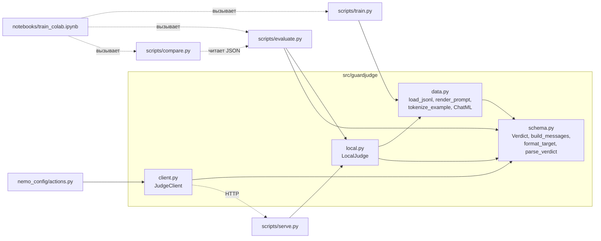
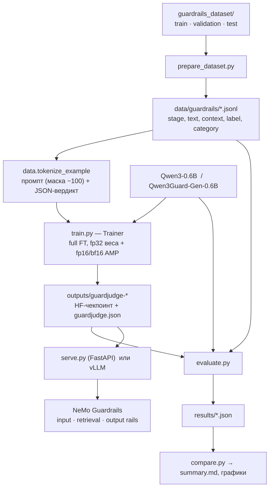
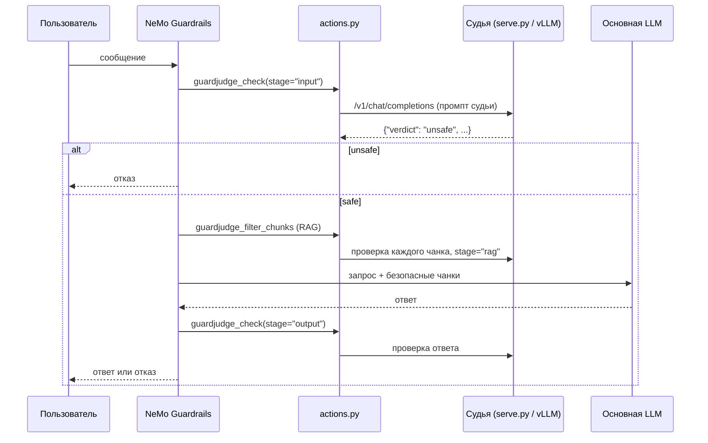
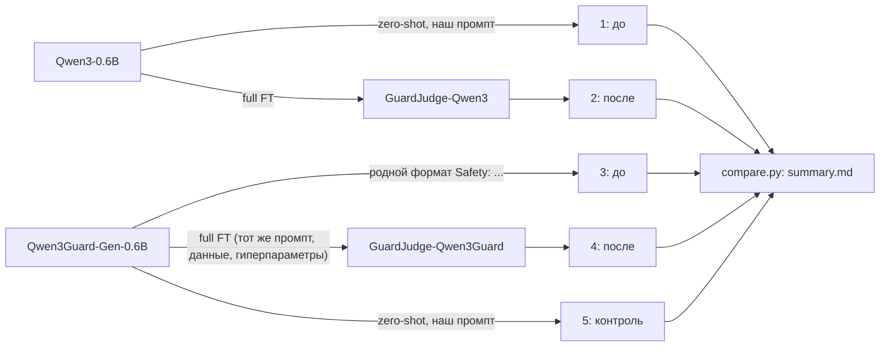

# Структура проекта GuardJudge

Краткая карта: какие есть модули и классы, что они делают и как связаны между собой.
Подробное описание каждой функции — в [CODE_REFERENCE.md](CODE_REFERENCE.md).

## Папки

```
guardjudge/
├── src/guardjudge/          библиотека (импортируется скриптами, сервером и NeMo)
│   ├── schema.py            промпт судьи, целевой JSON, разбор ответа
│   ├── data.py              JSONL, токенизация для обучения, ChatML-шаблон
│   ├── local.py             LocalJudge — модель в процессе (Transformers)
│   └── client.py            JudgeClient — клиент к серверу судьи
├── scripts/                 точки входа (запускаются из командной строки)
│   ├── prepare_dataset.py   guardrails_dataset → data/guardrails
│   ├── train.py             полное дообучение
│   ├── evaluate.py          метрики качества и задержки
│   ├── compare.py           сводная таблица по нескольким оценкам
│   ├── serve.py             FastAPI-сервер судьи
│   └── serve_vllm.sh        сервер на vLLM (Linux + GPU)
├── configs/                 YAML-конфиги обучения
│   ├── train_guardrails.yaml   Qwen3-0.6B на командном датасете
│   ├── train_qwen3guard.yaml   Qwen3Guard-Gen-0.6B, всё остальное то же
│   └── train_full.yaml         демо-данные, проверка пайплайна
├── notebooks/train_colab.ipynb  обучение и сравнение «до/после» в Colab
├── nemo_config/             рельсы NeMo Guardrails (actions.py, rails.co, config.yml)
├── data/
│   ├── demo_{train,val,test}.jsonl   36 строк, все 4 стадии (лежат в git)
│   └── guardrails/                   командный датасет после конвертации (генерируется, не в git)
├── docs/MODEL_CHOICE.md     обоснование выбора модели (текст для Google Doc)
└── tests/test_schema.py     pytest
```

**Почему `data/` весит мало.** В git лежит только демо-набор (36 строк). Командный датасет
создаёт `prepare_dataset.py` в `data/guardrails/`. Строк там столько же, сколько в исходнике
(43 493 / 6 294 / 5 506), но файлы весят около 28 МБ вместо 156 МБ. В исходной папке
каждая строка повторена три раза (`*.jsonl`, `sft_*.jsonl`, `text_only/`) и несёт большое поле `provenance`.
Нам нужны только текст, метка и несколько полей метаданных.

## Классы и главные функции

| где | что | зачем |
|---|---|---|
| `schema.py` | `Verdict` (dataclass) | результат проверки: `unsafe`, `category`, `parsed_ok` |
| | `build_messages()` | собирает промпт судьи: system и user (стадия, контекст, фрагмент) |
| | `format_target()` | целевой ответ для обучения: `{"verdict": ..., "category": ...}` |
| | `parse_verdict()` | достаёт вердикт из ответа: наш JSON, формат Qwen3Guard, формат Llama Guard |
| `data.py` | `load_jsonl()` | читает и проверяет датасет |
| | `CHATML_NO_THINK`, `apply_chat_template_override()` | общий ChatML-шаблон, чтобы Qwen3 и Qwen3Guard получали одинаковый промпт |
| | `render_prompt()` | промпт через chat template модели; один и тот же при обучении и инференсе |
| | `tokenize_example()` | `input_ids` и `labels`; loss считается только по вердикту |
| | `pad_batch()` | паддинг батча для Trainer |
| `local.py` | **`LocalJudge`** | модель в памяти: `generate()` (один запрос), `generate_batch()` (пакет), `judge()` (сразу вердикт) |
| `client.py` | **`JudgeClient`** | асинхронный HTTP-клиент к серверу судьи; если сервер недоступен, блокирует запрос (fail closed) |
| `serve.py` | `build_app()` → FastAPI | `/v1/chat/completions` (OpenAI-совместимый), `/judge`, `/health` |
| `evaluate.py` | `LocalBackend`, `HttpBackend` | откуда брать ответы модели: в процессе или по HTTP |
| | `metrics()`, `group_metrics()` | P / R / F1 / FPR / задержка, в целом и по группам |
| `train.py` | `main()` | конфиг → токенизация → `Trainer` → сохранение чекпоинта |
| `nemo_config/actions.py` | `guardjudge_check`, `guardjudge_filter_chunks` | действия NeMo: проверить фрагмент, отфильтровать RAG-чанки |

## Граф зависимостей модулей



## Поток данных: от датасета до гардрейла



## Как судья работает в пайплайне (NeMo Guardrails)



## Эксперимент «до / после» (ноутбук)


